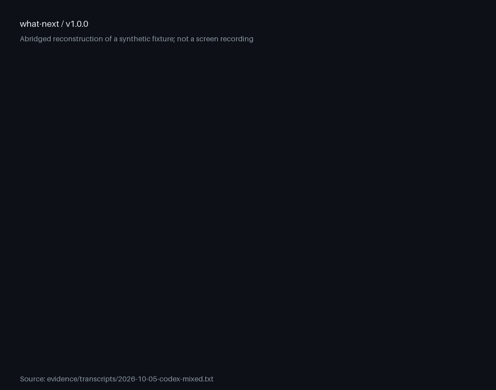

# what-next

Ask an agent what is left and you usually get a list padded
with questions it could have answered itself.

---

[](https://github.com/trycopilotai/what-next/actions/workflows/auto-lint-pr.yml)
[](https://github.com/trycopilotai/what-next/actions/workflows/check.yml)
[](https://github.com/trycopilotai/what-next/actions/workflows/lint.yml)

---

what-next makes an item earn the human lane: five sources
must fail to resolve it first, and it must then map to one
of exactly six capability gaps.

Historical record (edited): In the recorded run, two of six
human items were demoted.

Each demotion names the source that settled it, and the run
is in [`evidence/`](evidence/). That historical run is on
this project's own release thread. New client runs use
synthetic fixtures. Neither is a benchmark or an accuracy
measurement.

It writes the gap, not the task. "Deploy the service" is
never the human action; "run `gcloud auth login`" is.

It determines only. Running it does not execute the agent
lane — that lane is a proposal you authorize.

## Demo



This looping reconstruction derives its rows from the
[Codex output](evidence/transcripts/2026-10-05-codex-mixed.txt),
not a screen capture. For reduced motion, open the
[static poster](assets/demo-poster.png).

## What it returns

A two-lane table, then one to four next actions — through
the host's picker where there is one, as a plain list where
there is not.

### Agent lane — proposed, not started

| ID  | Proposed action          | Next tool/command                                                 | State         | Basis                                    |
| --- | ------------------------ | ----------------------------------------------------------------- | ------------- | ---------------------------------------- |
| A1  | Run the local tests      | `python3 -m unittest`                                             | independent   | Thread: tests are ready                  |
| A2  | Upload the built archive | `gh release upload v1.0.0 dist/package.zip --repo example/widget` | blocked on H1 | Thread: upload authorized, login missing |

### Human lane

| ID  | Needed from you     | Gap type               | Prepared                        | Unblocks | Basis                                                                    |
| --- | ------------------- | ---------------------- | ------------------------------- | -------- | ------------------------------------------------------------------------ |
| H1  | Run `gh auth login` | Interactive credential | Archive built; command supplied | A2       | Thread: authentication check failed; other sources n/a for private login |

### Next

1. H1: Sign in
2. A1: Run the tests

This is a **synthetic format example**, not a recorded run.
The actual behavior records are linked below.

Every agent item is `independent` or `blocked on Hn`. IDs
are used in all dependencies, preparation references,
unblock cells, and choices. Empty lanes render as `None`.
Unfinished preparation is proposed as an agent item; it is
not described as already completed. If more than four
actionable choices exist, the remaining count precedes the
picker or plain list.

Explicit invocation determines only, even with no human
blockers. An internal handoff check continues independent,
already-authorized work; it does not grant new scope.

## The six gaps

An item reaches the human lane only by mapping to one of
these. Nothing else qualifies.

1. **Interactive credential** — a login prompt, 2FA, OAuth
   consent, a keychain unlock.
2. **Physical or GUI-modal** — a device to plug in, an OS
   permission dialog, a restart, a hardware key tap.
3. **Policy-barred outward action** — the host's policy
   where it states one; otherwise five verbs and no others:
   publishing, sending, deploying, deleting, spending.
4. **Private judgment** — a preference held only in your
   head.
5. **Access you do not hold** — an account, a paywalled
   source, a machine off the network.
6. **Another person's act** — a reply, a review, a
   signature, a meeting.

Unfamiliarity, effort, reassurance, re-confirmation, and any
question a test or a `grep` would settle are explicitly not
gaps.

## Use it

### Claude Code

Save this as `install.sh` and run it. It sets `set -eu` and
an `EXIT` trap, so pasting it straight into an interactive
shell will end that shell if the clone fails.

```sh
set -eu
release=v1.0.0
install_parent="$HOME/.claude/skills"
install_target="$install_parent/what-next"
mkdir -p "$install_parent"
install_tmp="$(mktemp -d "$install_parent/.what-next.XXXXXX")"
install_stage="$install_tmp/package"
rollback_install() {
  if [ ! -e "$install_target" ]; then
    if [ -e "$install_tmp/previous" ]; then
      mv "$install_tmp/previous" "$install_target"
    fi
  fi
  rm -rf "$install_tmp"
}
trap rollback_install EXIT
git clone --quiet --depth 1 --branch "$release" \
  https://github.com/trycopilotai/what-next \
  "$install_tmp/what-next"
mkdir -p "$install_stage"
cp -R "$install_tmp/what-next/skill/." "$install_stage/"
if [ -e "$install_target" ]; then
  mv "$install_target" "$install_tmp/previous"
fi
mv "$install_stage" "$install_target"
trap - EXIT
rm -rf "$install_tmp"
```

Or, when this version is registered, alongside the other
[trycopilot.ai skills](https://github.com/trycopilotai/skills):

```text
/plugin marketplace add trycopilotai/skills
/plugin install what-next@trycopilotai
```

Invoke the directly installed skill as `/what-next`, or the
marketplace plugin as `/what-next:what-next`.

### Codex

Save this one the same way. The only line that differs from
the block above is `install_parent`.

```sh
set -eu
release=v1.0.0
install_parent="$HOME/.agents/skills"
install_target="$install_parent/what-next"
mkdir -p "$install_parent"
install_tmp="$(mktemp -d "$install_parent/.what-next.XXXXXX")"
install_stage="$install_tmp/package"
rollback_install() {
  if [ ! -e "$install_target" ]; then
    if [ -e "$install_tmp/previous" ]; then
      mv "$install_tmp/previous" "$install_target"
    fi
  fi
  rm -rf "$install_tmp"
}
trap rollback_install EXIT
git clone --quiet --depth 1 --branch "$release" \
  https://github.com/trycopilotai/what-next \
  "$install_tmp/what-next"
mkdir -p "$install_stage"
cp -R "$install_tmp/what-next/skill/." "$install_stage/"
if [ -e "$install_target" ]; then
  mv "$install_target" "$install_tmp/previous"
fi
mv "$install_stage" "$install_target"
trap - EXIT
rm -rf "$install_tmp"
```

Or, when this version is registered, from the marketplace:

```sh
npx -y @openai/codex plugin marketplace add \
  trycopilotai/skills
npx -y @openai/codex plugin add what-next@trycopilotai
```

Invoke the directly installed skill as `$what-next`, or the
marketplace plugin as `$what-next:what-next`. Codex selects
skills with `$`; `@` is the ChatGPT form and is not a Codex
selector.

The four forms are two pairs. A skill you cloned yourself is
addressed by its own name — `/what-next` in Claude Code,
`$what-next` in Codex. A skill installed from a marketplace
is namespaced by the plugin it arrived in, so it takes the
longer form: `/what-next:what-next` and
`$what-next:what-next`. If one is not recognised, it is the
form for the install you did not do. Do not go looking in
`codex plugin list` for it: that lists plugins, not the
selectors their skills answer to.

For a checked-out repository, Claude also supports
`claude --plugin-dir /absolute/path/to/what-next` and
`/what-next:what-next`. Codex can load the local catalogue:

```sh
codex plugin marketplace add /absolute/path/to/what-next
codex plugin add what-next@trycopilotai-what-next
```

The `v1.0.0` tagged repository carries a portable root
`plugin.json` plus Claude Code and Codex plugin manifests.
Both runtimes load the canonical package under
`skills/what-next`; `skill/SKILL.md` resolves to that
package, so the skill content is stored once.

The clone is pinned to a tag rather than to `main`. This
file is an instruction set that steers an agent, so a
mutable branch would silently change what it is told to do.
Read
[`skills/what-next/SKILL.md`](skills/what-next/SKILL.md)
before you invoke it. (`skill/` is a symlink to that
directory, which GitHub's web view will not follow.)

Whether you need to restart depends on the runtime and on
the install route, so all four cases are spelled out.

Claude Code picks up a directly installed skill in the
current session; restart only if the top-level skills
directory did not exist when the session started. For a
plugin it reports either `Plugin is now active.` or
`Run /reload-plugins to activate.` — do whichever it says.

Codex detects a directly installed skill automatically, with
no directory rule, and picks up a plugin-bundled skill in a
session started after the install. If a skill does not
appear, restart Codex.

## When to use it

- You asked "what next", "what's left", "what do you need
  from me", or "what can you do without me".
- A thread has accumulated open commitments and it is no
  longer obvious what is blocked.
- A plan finished and the residue needs routing.

For an explicit invocation with no open work, both lanes are
`None` and there are no choices. Do not use it internally to
manufacture a stopping point.

## Evidence

`evidence/transcripts/2026-08-20-release-thread.txt` is a
real run, captured mid-task while this repository was being
prepared for publication. `evidence/manifest.json` records
the skill's SHA-256, the agent and version, the invocation,
and the output hash.

Fresh v1.0.0 runs and their synthetic inputs are indexed in
[`evidence/v1.0.0.json`](evidence/v1.0.0.json). The output
files are unchanged final messages from actual CLI sessions;
the manifest identifies the input commit, skill hash, client
version, model, invocation, and output hash. Noninteractive
runs exercise the plain-list fallback, not a native picker.

Interactive Claude Code 2.1.289 did open an ID-labelled
native picker, but omitted the tables beforehand. That is a
[known limitation](https://github.com/trycopilotai/what-next/issues/2),
not a passed native table-order test. The adapter permits
full-report text fallback when a host cannot show the lanes
first. The selected, edited tool-input record is in
[`evidence/native-picker.json`](evidence/native-picker.json).
That record uses an earlier private source snapshot, not the
final org protocol. Its input fixture and skill hash
identify what was exercised; it does not validate the
current adapter's native rendering.

Heading levels and punctuation vary between the captured
outputs. Tests enforce the lane order, exact columns, IDs,
references, preparation facts and choices; they do not claim
model responses are a deterministic Markdown renderer.

**The protocol has moved since the historical run.** The
output contract has gained three rules since the recorded
run. It falls short of two of them — it carries no
`checked:` field and ends without an options list. The
third, a `Demoted on the gate` block, the run already
satisfies. The v1.0.0 contract now replaces that block and
field with fixed tables and `Basis` cells, adds `A1` IDs,
and specifies host-native picker constraints and text
fallback. Those fields were not back-filled — writing them
now would be inventing what the run did, which is the one
thing this repository argues against.
`evidence/manifest.json` lists every revision, and the
transcript's header says which rules it predates.

**The record is edited, and says so.** The run happened on a
private thread, so before publication a signing key's path,
two script names, and one configuration key were replaced
with prose naming the same things generically. No item was
added or removed and no classification was changed — every
lane, tag, gap type and demotion is as the run produced it.
Two smaller edits are recorded alongside it: the sentences
framing the item counts were reworded, and an options list
composed during review was removed again as improper.
`evidence/manifest.json` carries `"edited": true` with all
three, and a test fails the build if that declaration goes
missing.

**Not measured, stated up front.** There is no benchmark or
accuracy figure. The animated demo is a labelled
reconstruction. The historical run is not independent: the
protocol was applied to this project's own release thread by
the same agent that was building the repository, so it is a
demonstration that the gate fires, not evidence that the
split generalises to other threads or other agents. The
fresh synthetic runs check a specified fixture, not
independent real-world task performance. A run on an
ordinary thread is still the most useful contribution.

## Release provenance

The v1.0.0 update incorporates the output contract from an
exact private source commit, recorded in
[`evidence/provenance.json`](evidence/provenance.json). Only
selected, audited instructions and interface metadata were
carried over. Private host-specific examples were not. This
repository retains its MIT license and existing history. It
is an append-only update, not a new repository or a passed
creation-only controller transaction.

The v1.0.0 tag preserves the documentation from its initial
private release. The operator has since authorized public
publication of this org repository. Use this README and
[`SECURITY.md`](SECURITY.md) for current installation and
reporting guidance. The private source repository and
external audit records are not part of that publication.

## Contributing

See [`CONTRIBUTING.md`](CONTRIBUTING.md). The most useful
report is a run where the split was wrong, or a
human-required item that maps to none of the six gaps.

## License

MIT license. See [`LICENSE`](LICENSE).

## Not affiliated with GitHub or GitHub Copilot

The `trycopilotai` organisation name is not a claim of any
relationship with GitHub Copilot. This project is not
affiliated with, endorsed by, or sponsored by GitHub, Inc.
GitHub and GitHub Copilot are trademarks of GitHub, Inc.
